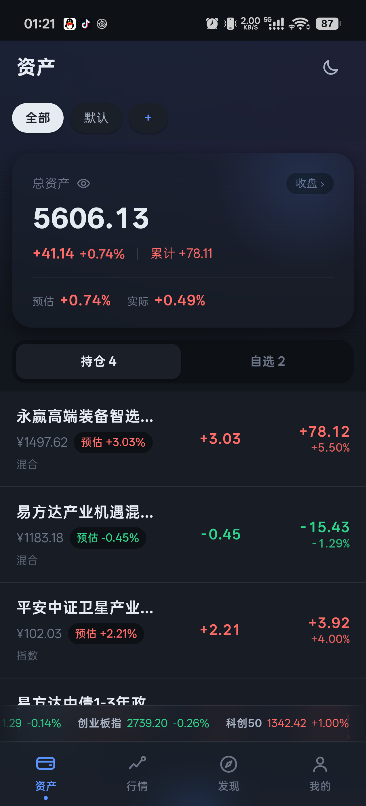
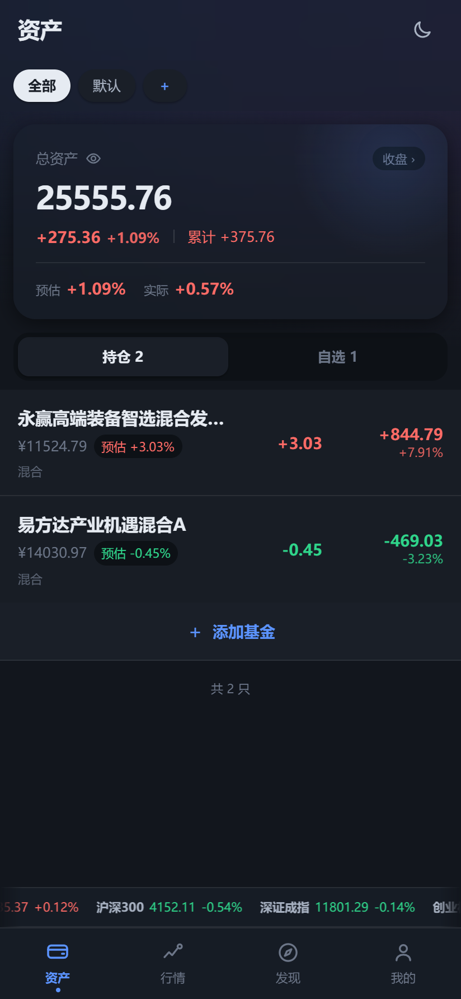
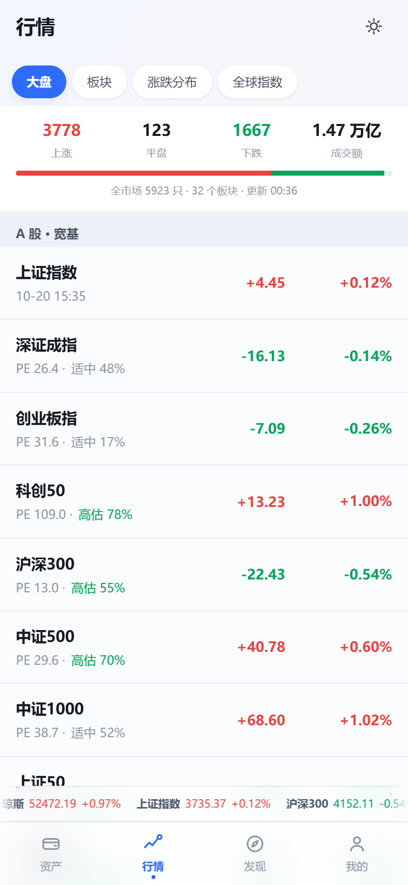
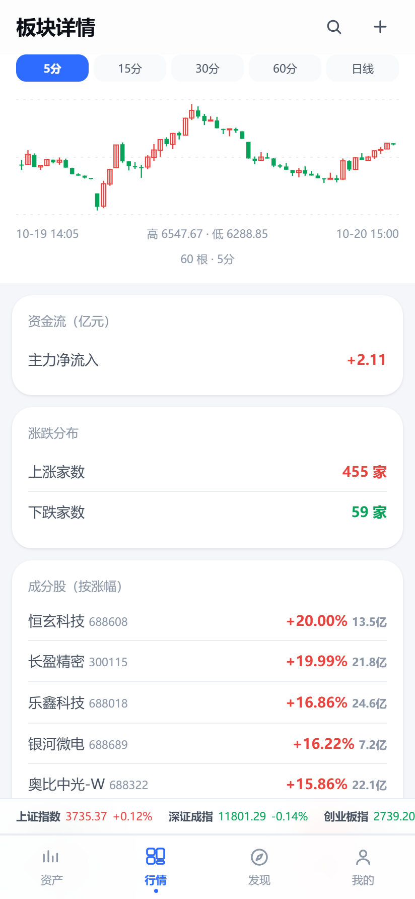

# 养基宝 Lite

[](https://github.com/deepseek-ai/deepseek-harness)


> 一个 **2.1 MB** 的基金持仓 App：无广告、无账号、无后台、数据全在本机。
> 盘中用指数回归 + 重仓股加权预估净值，再用 **DeepSeek** 做误差归因，越用越准。

**整个仓库和这个 App 全部由 AI 编写。** 人只负责提需求、验收、拍板。

---

## 为什么会有这个项目

原版「养基宝」是 Flutter AOT 编译 + 服务端权威 API，带 TLS 指纹校验和签名接口。
它的问题不是技术上的，是产品上的：开屏广告、信息流广告、账号体系、持仓数据上传云端。

逆向评估后的结论很直接——**逆它的成本远高于重写一个**。于是有了这个项目：

| | 原版 | 这个版本 |
|---|---|---|
| 体积 | 78 MB | **2.1 MB**（−97%） |
| 广告 | 开屏 + 信息流 | **零** |
| 账号 | 强制登录 | **不需要** |
| 持仓数据 | 上传服务端 | **只在本机**，连备份都不做 |
| 冷启动 | — | **253 ms** |
| 帧率 | — | **121 fps**（120Hz 跑满） |
| 网络请求 | 私有签名接口 | 全部公开数据源 |

---

## 它能做什么

<table>
<tr>
<td width="25%"></td>
<td width="25%"></td>
<td width="25%"></td>
<td width="25%"></td>
</tr>
<tr>
<td align="center">资产 · 预估 vs 实际</td>
<td align="center">深色 · 毛玻璃</td>
<td align="center">行情 · 板块</td>
<td align="center">板块分钟 K 线</td>
</tr>
</table>

**资产**
- 持仓 / 自选合并成一个列表，一份关注清单
- 总资产卡：今日盈亏、累计收益、**盘中预估 vs 已公布实际**分开显示
- 分红分两种口径算清楚：现金分红（进余额，市值看不出来）、红利再投（份额已变大，不能重复加）
- 组合估值（PE 分位）—— 整个组合贵不贵，比单看一只更有意义
- 点总资产卡 → **历史总资产涨跌**（金额口径，不是百分比）

**行情**
- 大盘：A 股宽基 + 全市场涨跌家数 + 成交额
- 板块：涨跌幅 / 市值 / 成分股数排序，逐个可点进去
- 板块详情：**分钟级蜡烛 K 线**（5/15/30/60 分 + 日线）、资金流、涨跌分布、成分股按涨幅排
- 涨跌分布：9 个区间的全市场统计
- 全球指数：港股 / 美股 / 欧洲 / 亚太
- 底部指数条：9 个指数**无缝循环滚动**（48 px/s 恒速，按住暂停）

**发现**
- 板块情绪：基于涨跌幅、涨跌家数、平台热度合算的 0–100 分
- 资讯：5 个源合并去重，按板块筛选，正文在 App 内提取（不跳浏览器）

**我的**
- 主题：日间 / 夜间 / 跟随系统，顶栏一键切换
- 运行日志、数据源自检、JSON 导出
- **AI 校准**：自己填 API Key，用 DeepSeek 做误差归因

---

## 预估是怎么算的

盘中基金净值还没公布，但市场在动。三种方法各有各的适用面：

| 方法 | 适用 | 原理 | 弱点 |
|---|---|---|---|
| **指数回归** | 指数型、ETF 联接 | β = Σ(R·Y) / Σ(R²)，用跟踪指数涨跌推基金涨跌 | 主动基金没有跟踪标的 |
| **重仓股加权** | 主动型 | 季报前十大重仓的实时涨跌 × 占净值权重 | 季报最长滞后 4 个月 |
| **近期均值** | 债券 | 波动只在万分之几，均值最稳 | 行情一变就失灵 |

不是"选一个最信的"，而是**三个都算、按历史误差反向加权融合**：

```
w = 类型先验 × 本次置信度 × 历史误差权重 × 误差趋势 × AI 校准系数
```

其中几个细节值得单独说：

**误差账本**：每只基金每个模型都记一本账（样本数、平均绝对误差、最近 8 次明细），
指数衰减让模型能跟上市场变化。

**季报新鲜度按「发布日」算，不是「报告期」**。
这两者差 3 周，混淆会得出**相反**的结论：报告期 6/30，今天 7/10，
按报告期算"才过 10 天，很新"——但这份报告根本还没发布，
手上真正拿到的是 3/31 那期，已经过期三个半月。
法规是季度结束后 15 个工作日披露，所以按 +21 天估发布日，年报按次年 3/28。
一年有 4 个这样的窗口、合计约 84 天，旧逻辑在这段时间给了过期持仓满分信任，现在压到 0.25。

**历史收益用时间加权收益率（TWR）**：

```
r(t) = (今日市值 − 昨日市值 − 今日净流入) / 昨日市值
```

减掉净流入这一步是关键。没有它，用户加仓当天市值凭空变大，曲线会当成"赚了"往上跳；
没有持仓流水，就只能假设"他从头就持有这套组合"——新用户会看到买入之前那段时间也在涨跌。
所以加了持仓变更流水，能还原「那天到底持有了多少份额」，加仓 / 减仓 / 清仓都算得对。

---

## AI 校准：只做元决策，不做数值回归

**为什么不让 AI 直接算净值**：LLM 是采样输出，同一输入两次可能给 0.93 和 0.9322；
延迟十几秒且不确定，而盘中估值要频繁刷新。数值回归交给本地最小二乘，它又快又可复现。

**AI 干什么**：本地只能知道"误差变大了"，说不出为什么。把今日差异 + 历史差异 + 持仓新鲜度
摆给 DeepSeek，它能判断出是基金经理换仓了、指数 β 漂了、还是季报过期了，
并给出两个模型的权重调整建议。

实测对话：

```
输入误差：index  +0.21 -0.33 +0.33 -0.23 -0.03
          holdings  +0.55 -0.42 +0.38

AI 诊断：「指数拟合不准，β漂移，误差来回跳」
调整建议：index×0.6  holdings×1.0  置信 0.5
```

**启动数据**：新用户点"立即校准"时一个样本都没有怎么办？
不预置假数据，而是**用真实历史回演**——净值历史和指数历史本来就在手上，
按日期对齐逐日比一遍就能算出真实误差：

```
预估 = 指数当日涨跌 × β
误差 = 预估 − 实际
```

主动基金认不出跟踪指数时，用沪深300 作代理，并**如实告诉 AI 这是代理**。
实测 AI 拿到这个信息后自己就说出了「指数代理失准，β漂移，压指数」。

**四层保护**（避免 AI 一直崩）：结果缓存 / 失败退避（连败 3 次冷却 30 分钟）/
串行 + 90 秒超时 / 完全降级（任何失败都不影响原有预估）。
输出一律钳制：权重 0.6–1.5，置信度 < 0.4 整条丢弃。

### 配置 AI

**开源版不内置任何 API Key**，需要自己填（我的 → 设置 → AI 接口配置）。

走 OpenAI 兼容协议，所以不止官方 API：自建代理、本地 Ollama 的 `/v1`、
各家云厂商的兼容端点都能用。默认填的是 `deepseek-v4-flash`。

Key 只存在你手机的本地库里，不上传、不外发。

---

## 技术栈

**一句话：Kotlin + 单 Activity + 系统 WebView + 单页 HTML/CSS/JS。**

这个选型是审计后**故意不换**的，不是偷懒：

| 候选 | 判决 | 理由 |
|---|---|---|
| **Kotlin + WebView** | **采用** | 性能达标，界面零重写 |
| Tauri 2 (Rust) | 否决 | UI 仍是 WebView，只换外壳，要重写全部原生桥 |
| Kotlin + Compose | 否决 | HTML 界面必须整体重写 |
| Flutter / RN | 否决 | 同上，还引入更大运行时 |

决定性证据：优化前 APK 22.4MB 里 **79.8% 是 ML Kit OCR** 的 native 库，UI 层只占 1.9%。
换 UI 技术栈对体积和性能几乎零影响，却要重写全部界面。

**数据层**用 IndexedDB（`db` 模块）：内存为真相、异步落盘、localStorage 兜底。
不用 SQLite 是因为数据全在 JS 侧，走 JS↔Java 桥每次读写都是一次 IPC，
而 `holdCache` / `predLog` 是高频小读写，跨进程反而更慢。

**桥接**只有 25 个 `@JavascriptInterface` 方法，回调走 `window.__onNative(cbId, ok, payload)`。

---

## 数据源

全部公开接口，无签名、无私有协议。**没有任何一个需要账号。**

| 用途 | 来源 |
|---|---|
| 基金净值（最及时） | 天天基金 `api.fund.eastmoney.com/f10/lsjz` |
| 基金全量历史 / 分红 | `fund.eastmoney.com/pingzhongdata` |
| 基金重仓股 | `fundf10.eastmoney.com` |
| 日线 / 分钟 K 线 | 新浪 `quotes.sina.cn`（腾讯备用） |
| 指数行情 | 新浪 `hq.sinajs.cn` / 腾讯 `qt.gtimg.cn` |
| 板块热力图 / 成分股 | `map.findfin.app` |
| 指数估值（PE 分位） | 蛋卷 `danjuanfunds.com` |
| 板块情绪 / 热榜 | 同花顺 `dq.10jqka.com.cn` |
| 涨停 / 跌停池 | 东财 `push2ex.eastmoney.com` |
| 资讯（5 源） | 新浪 / 同花顺 / 东财 ×3 |

> 已知限制：东财 `push2` 系列在部分网络整片不可达；
> 腾讯 `web.ifzq.gtimg.cn` 在移动网络下返回 501（已做双源降级）。
> `map.findfin.app` 偶尔 7~23 秒，已加重入保护与缓存。

---

## 下载

前往 [**Releases**](../../releases) 下载最新 APK，直接安装。

- 要求：Android 7.0（API 24）以上
- 已签名（v1/v2/v3），16KB 页对齐
- 体积：2.1 MB

## 构建

```bash
# 环境：JDK 21 / Android SDK 35 / Gradle 8.7
./gradlew assembleRelease

# 产物在 app/build/outputs/apk/release/
```

签名脚本见 `tool/build_all.sh`（含 zipalign -P 16 + apksigner + 产物校验）。

---

## 关于「AI 开发」

这个项目是一次完整的 AI 造物实验，值得如实记录：

- **全部代码由 AI 生成**：Kotlin 2,261 行 + HTML/CSS/JS 13,000+ 行
- **全部 UI 由 AI 设计**：配色、栅格、图标（内联 SVG）、动画曲线
- **全部架构决策由 AI 做出**：包括上面那张"为什么不换栈"的对比表
- **全部 bug 由 AI 定位修复**：前后修了 40+ 个，含若干只有真机日志才能发现的

人做的事只有三件：**提需求、验收结果、拍板取舍**。

一些只有实际做起来才会暴露的坑，也一并留在这里：
返回键脚本里 `window.nav` 永远是 `undefined`（`const` 声明不进 window）、
手势中途注销返回回调会切断整条链路、WebView 的 `input tap` 按下时长太短不认、
`toISOString()` 是 UTC 会让日志时间少 8 小时。
这些都不是猜出来的，是读日志读出来的。

---

## 许可证

**本项目采用「专利许可（Patent License）」：个人与非商业用途免费，商业用途需授权。**

详见 [LICENSE](LICENSE)。

| 场景 | 是否需要授权 |
|---|---|
| 自己用、学习、改着玩 | ✅ 免费 |
| 个人项目、非营利分发 | ✅ 免费 |
| 公司内部使用 | ⚠️ 需授权 |
| 商业产品集成 | ⚠️ 需授权 |
| 二次销售 / 托管服务 | ⚠️ 需授权 |

商业授权请联系仓库所有者。

---

## 免责声明

本项目仅用于学习与技术研究。所有数据来自公开接口，**不构成任何投资建议**。
基金估值存在固有误差，请以基金公司官方公布的净值为准。
使用本软件进行投资决策的风险由使用者自行承担。

---

<p align="right">
<a href="https://github.com/deepseek-ai/deepseek-harness">


</a>
</p>
